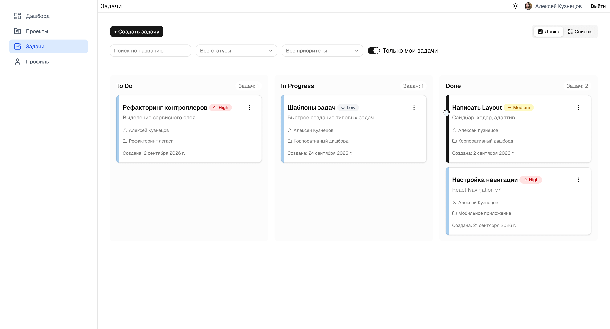
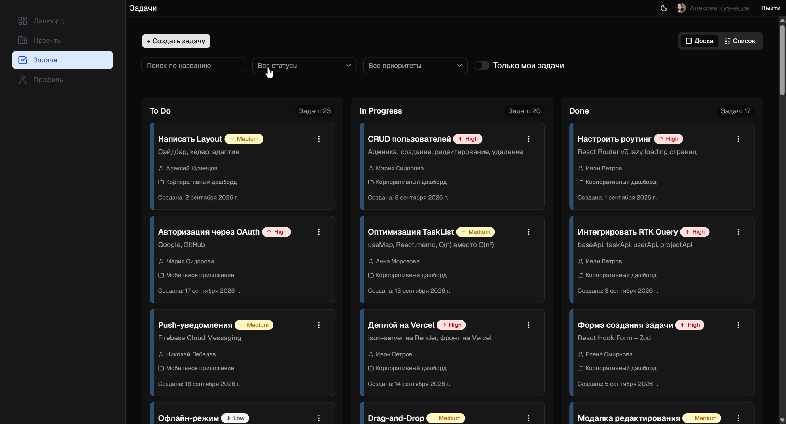
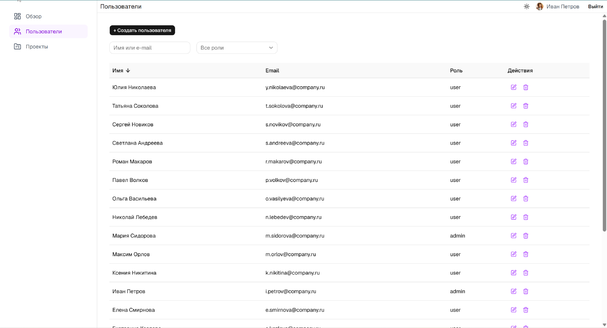
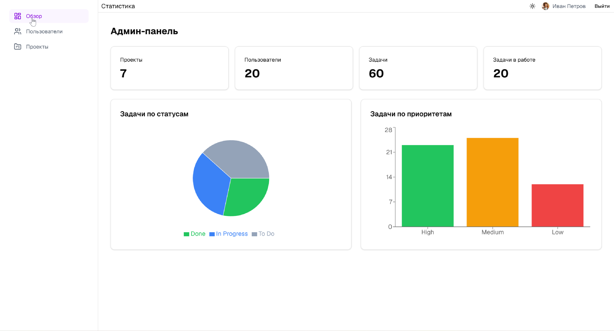

# Corporate Dashboard (Task & Project Management)

SPA-приложение для управления проектами и задачами с ролевой моделью
(Admin/User), оптимистичным Drag-and-Drop и аналитикой.

**🔗 Демо:** https://tasks-dashboard-eight-jet.vercel.app/  
**🔗 API (json-server):** https://dashboard-api-8ams.onrender.com

|           Light theme & D&D            |            Dark Theme            |
| :------------------------------------: | :------------------------------: |
|  |  |

|             Админка пользователей              |               Аналитика                |
| :--------------------------------------------: | :------------------------------------: |
|  |  |

## 🛠️ Стек технологий

- **Core:** React 19, TypeScript, Vite
- **Архитектура:** Feature-Sliced Design (FSD) с контролем через Steiger
- **State Management:** Redux Toolkit (RTK) + RTK Query
- **UI:** Tailwind CSS v4, shadcn/ui (Base UI)
- **Формы и валидация:** React Hook Form + Zod
- **Роутинг:** React Router v7 (Data Router, Protected Routes, View Transitions)
- **Тестирование:** Vitest, React Testing Library
- **Инструменты (Tooling):** Oxlint, Git hooks (pre-push: lint + test)
- **AI-assisted Development:** Cline + GLM 5.3 (генерация тестов, рефакторинг)
- **Деплой:** Vercel (Frontend), Render (Backend)

## 🚀 Ключевые фичи

- **Drag-and-Drop (Kanban):** Перетаскивание задач между колонками с
  **оптимистичным обновлением** (UI не ждет ответа сервера).
- **Ролевая модель:** Админ-панель с CRUD пользователей/проектов + защита
  маршрутов (`ProtectedRoute`).
- **Аналитика:** Визуализация задач по статусам и приоритетам (Recharts).
- **Темы:** Светлая/темная тема + отдельный скоуп стилей для админки (через
  `data-theme`).
- **Фильтрация:** Поиск, фильтры по статусу, приоритету и "Только мои задачи".

## 🧠 Архитектурные решения (Trade-offs)

- **Почему RTK Query, а не Zustand?** Д Для проекта было важно разделить
  клиентское и серверное состояние. RTK Query я использовал для API (кэш,
  дедупликация, инвалидация тегов после DnD и CRUD).

  Для клиентского состояния (тема, авторизация) я оставил Redux Toolkit, так как
  у меня уже была настроена инфраструктура (middleware для localStorage,
  селекторы, интеграция с RTK Query). Zustand был бы проще для UI-состояния, но
  переезд потребовал бы переписывания middleware и провайдеров, что не окупалось
  на этом этапе.

  Если бы я начинал проект с нуля, я бы рассмотрел комбинацию RTK Query (для
  сервера) + Zustand (для UI). Но в текущей архитектуре два инструмента создали
  бы лишнюю сложность без реальной выгоды.

- **Почему shadcn/ui, а не готовая библиотека (MUI, Chakra)?** Я выбрал
  shadcn/ui (на базе Base UI), потому что он дает полный контроль над
  компонентами. В отличие от прочих библиотек, здесь код компонентов лежит в
  моем проекте, и я могу его кастомизировать под дизайн без борьбы со стилями.
  - **Гибкость:** Tailwind v4 + `render`-проп вместо `asChild` (актуальный
    подход Base UI).
  - **Легковесность:** Нет тяжелого рантайма, как у MUI.
  - **Скорость:** Я не тратил время на написание `Button` или `Dialog` с нуля.
- **Почему Feature-Sliced Design (FSD)?** Для пет-проекта можно было взять
  плоскую структуру, но я выбрал FSD, чтобы показать навык работы с
  масштабируемой архитектурой и избежать каши при росте.
  - **Контроль:** Steiger автоматически следит за изоляцией слоев и соблюдением
    правила Pages First.
  - **Trade-off:** Настройка заняла время (алиасы, линтер), но это оправданная
    инвестиция для портфолио.

## 🐛 Инженерные вызовы (Challenges)

- **Несовместимость React 19.3 + react-hook-form 7.88:** `reset(values)`
  сбрасывает состояние формы, но не обновляет DOM-инпуты  
  **Решение:** `reset()` признан избыточным — форма уничтожается вместе с
  модалкой, а `defaultValues` подставляются при следующем открытии.
- **HMR + json-server:** При изменении `db.json` Vite перезагружал страницу,
  ломая Drag-and-Drop. **Решение:** настроил `server.watch.ignored` в
  `vite.config.ts`, чтобы исключить файл БД из отслеживания изменений.

## 📂 Структура проекта (FSD)

```text
src/
├── app/          # Роутер, провайдеры, middleware, глобальные стили
├── pages/        # Страницы (Tasks, Admin, Profile, Dashboard)
├── widgets/      # Композиционные блоки (Sidebar, Header, TaskBoard)
├── features/     # Сценарии пользователя (Auth, Theme, TaskFilters)
├── entities/     # Бизнес-сущности (Task, User, Project)
└── shared/       # Инфраструктура (UI-кит, API-клиент, утилиты)


features/task-filters/
├── model/
│   └── useFilteredTasks.ts   # Логика фильтрации
├── ui/
│   └── TaskFilters.tsx       # UI фильтров
└── index.ts                  # Публичный API фичи
```

## 🧪 Тестирование

- Покрыты: Zod-схемы, формы (валидация + вызов мутаций), удаление задач.
- Используются моки для RTK Query и `userEvent` для эмуляции действий
  пользователя.

## 🚦 Запуск локально

1. `npm install`
2. `npm run dev:all` (запускает Vite + json-server)

## 🚧 Ограничения и планы (Roadmap)

- **Мобильная версия:** Адаптив под телефоны пока не реализован. Вместо этого
  сделан акцент на десктопный UX (сжатие сайдбара, минимальная ширина контента
  1024px).
- **Авторизация (имитация):** В демо-версии логин реализован без пароля (выбор
  пользователя из списка), с сохранением пользователя в `localStorage`. Это
  сделано для упрощения демонстрации ролей (`admin`/`user`). В продакшене я бы
  использовал **JWT** (access + refresh tokens), **httpOnly cookies** для защиты
  от XSS и серверную валидацию прав на каждом запросе.
